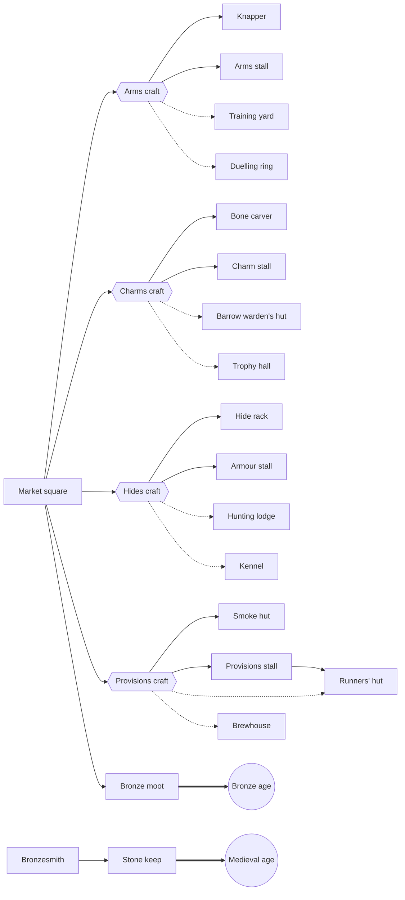

# Build chains

What opens what in the blueprint draft. Generated from data/crafts.json, data/buildings.json and data/upgrades.json
by `tools/chains.gd`; don't edit it by hand. Change the data, then run
`~/godot/godot --headless --path . -s res://tools/chains.gd` (tests/test_chain_chart.gd fails until you do).

Solid arrows: drafting or raising the first brings or allows the second. Dotted: a craft opens a building, which
the draft offers only once the town has that craft (a founding tradition's buildings are never held back).

## Upgrades by building

One draft offer a round builds on what the town has: an upgrade for a building that stands, a building a craft opened,
or another craft once the market is in.

| Building | Upgrades |
| --- | --- |
| Blacksmith | Practised smiths (blue) |
| Bone carver | Practised carvers (blue) |
| Brewhouse | Deep kegs (yellow) |
| Bronzesmith | Practised casters (blue) |
| Field | Crop rotation (white) |
| Forester's hut | Coppicing (blue), Forest paths (blue) |
| Garden patch | Raised beds (blue) |
| Gate | Banded gates (blue) |
| Hide rack | Practised tanners (blue) |
| Hunting lodge | Game warden (blue), Skinning knives (white) |
| Hut | Sturdy huts (blue) |
| Kennel | Bigger kennel (yellow) |
| Knapper | Practised knappers (blue), Second bench (white) |
| Longhouse | Wide longhouse (white) |
| Mead hall | Feather beds (blue) |
| Seer's tent | Seer's lamps (orange) |
| Smoke hut | Practised smokers (blue) |
| Spirit shrine | Healing spring (blue) |
| Stone-layers' yard | Deep quarry (white) |
| Training yard | Sparring posts (blue) |
| Watch post | Fletchers' arrows (white), Tall posts (blue) |
